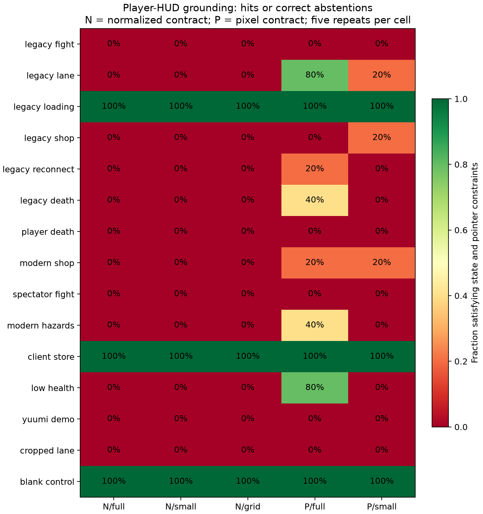
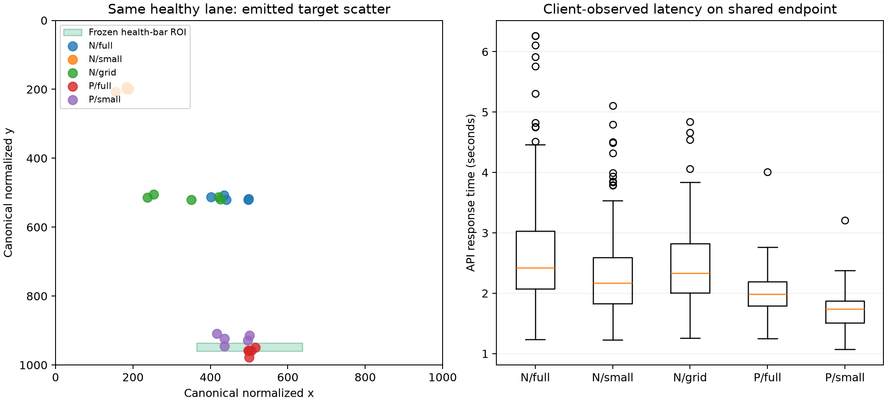

# Recorded League screenshot reactions

The capture-to-model-to-input path works in the isolated Windows screenshot
viewer. The tested DeepSeek V4.1 Flash policy has substantial perception and
grounding errors. **600 recorded trials** yielded **405 native input actions**,
**194 verified waits**, and **one input correctly blocked after an OS notification
obscured the image**. These are static-image tests, not live League outcomes.

## Data and execution

The [original protocol](static-screenshot-benchmark.md) uses 14 distinct public
League screenshots and a blank control. It covers combat, critically low health,
laning, area hazards, shops, death, loading, reconnecting, spectator footage,
the client store, and cropped gameplay without a player HUD. The
[source manifest](../benchmarks/league-static-v1.json) records URLs and hashes.
Sources include [Gamingcfg's archive](https://www.gamingcfg.com/screenshots/lol),
[Riot's Yuumi page](https://www.leagueoflegends.com/en-us/champions/yuumi/), and
[Epic's beginner guide](https://store.epicgames.com/news/a-beginner-s-guide-to-league-of-legends?lang=en-US).
Source publication dates do not establish screenshot patch dates. The corpus
contains archived interfaces and does not validate the current patch.

The original run contains 450 trials: 15 scenarios x 3 views x 2 tasks x 5
repetitions. Views are 960x540, a 384x216 downsample, and a coordinate-grid view.
Tasks are immediate action selection and locating the player's main HUD health
bar. A declared follow-up requests image pixels rather than normalized
coordinates: 15 scenarios x 2 views x 1 grounding task x 5 repetitions = 150.
The follow-up uses the same corpus and is a post-observation interface ablation.

All 600 API responses reported `deepseek-ai/DeepSeek-V4.1-Flash`, stopped normally,
passed the strict decision parser, and reported zero reasoning tokens.
Temperature was 0.6. The existing shared endpoint was used without deployment
changes. Images, prompts, responses, action plans, native events, and timestamps
are recorded. Scenario IDs, filenames, and annotations were excluded from model
input. Raw web images and interactive recordings remain in the private local run;
the repository contains source metadata, plots and all 600 compact trial records.

## Decision and grounding results

The original run matched all 450 broad screen-state labels. Its immediate-action
task satisfied the declared constraints on **194/225 trials (86.2%)**. This is
not expert-optimal gameplay accuracy: several actions are admitted in lane scenes,
while explicit rules govern waiting and closing shop overlays. Health recognition
was scored separately and matched **324/450 labels (72.0%)**.

Precise pointer grounding was much worse:

| Coordinate contract and view | HUD-present hits | No-HUD correct abstentions |
| --- | ---: | ---: |
| Normalized, full | 0/45 | 15/30 |
| Normalized, small | 0/45 | 15/30 |
| Normalized, grid | 0/45 | 15/30 |
| Image pixels, full | 14/45 | 15/30 |
| Image pixels, small | 3/45 | 15/30 |

Compare the 150 matched full/small grounding trials across contracts, rather than
the mixed-task 450-trial total against the 150-trial follow-up. Pixel coordinates
improved HUD-present hits from **0/90 to 17/90 (18.9%)**. The full-view median
distance from the frozen health-bar region fell from **234.36 px to 7.56 px**.
This supplemental distance is measured on emitted HUD-present clicks and excludes
abstentions; it does not change the frozen hit criterion. Many residual misses
land near the wrong HUD row or wrong panel.



## Variance and weak points

- **Coordinate units:** normalized requests often produced pixel-like targets.
  Coordinate-grid guides did not produce a single HUD hit in this run. Explicit
  pixel requests brought many targets closer, without providing reliable hits.
- **Small inputs:** pixel-contract hits fell from 14/45 at 960x540 to 3/45 at
  384x216. The image-token counts were 314 and 192 respectively. Less detail
  reduced input tokens while making an already difficult localization task worse.
- **Health reading:** the critical scene visibly shows **23/1185 HP**. None of its
  15 original immediate-decision trials labeled health critical: nine called it
  healthy, five low, and one unknown. The ten pixel follow-up probes all called
  it healthy. An admissible movement action can coexist with an incorrect reason.
- **Hallucinated control/HUD:** the spectator broadcast, official Yuumi crop,
  and editorial lane crop repeatedly elicited HUD clicks despite lacking a player
  HUD under the task definition. The original grounding task recorded 45 such
  false clicks; the matched pixel follow-up recorded 30.
- **Confidence:** 131 original trials and 50 follow-up trials were wrong under
  the frozen constraints while reporting confidence at least 0.8. These scores
  should not be treated as calibrated probabilities.
- **Same-image variance:** the full-view hazard scene selected movement in three
  of five immediate-decision repeats and waiting in two. Emitted target scatter
  was 134.5 normalized units RMS. Consistency also did not imply correctness:
  numerous HUD targets were repeatedly misplaced.



## Timing

| Experiment | Mean API response | API p95 | Mean capture-to-verification |
| --- | ---: | ---: | ---: |
| Original 450 trials | 2.479 s | 4.060 s | 2.664 s |
| Pixel follow-up 150 trials | 1.864 s | 2.444 s | 2.064 s |

Every request missed a 250 ms reaction deadline. These client-observed timings
include network, scheduling, image processing and generation on a shared service.
They are not isolated GPU inference measurements or a sustained policy Hz test.
Conditions ran sequentially; source-only exploratory probes overlapped early
requests. Task mix, cache state, and shared load differ across experiments, so
the follow-up's lower latency cannot be attributed to coordinate units alone.
The tested path is suitable for offline analysis and slower decisions, not a
demonstrated fast reaction controller.

## Recording audit and limitations

Both audits verify the complete predeclared matrices, source-renderer pixel
identity, PNG/RGB hashes, downsampling, model-input binding, coordinate mapping,
native release/key receipt, response pixels, and timestamp causality. Each trial
has a distinct actual capture ID. Native execution used Windows 11 build 26100,
Python 3.12.10, MSS 10.2.0, Pillow 12.3.0, and the existing input SDK. The model ran
on the existing remote service. A footer outside model input confirms receipt;
the underlying League image remains static.

At trial 391 an OS notification covered the viewer. Its changed-image guard
prevented input. The run retained that failed record and resumed only 59 missing
cells after ordinary notification dismissal. All original 391 trial files remain
byte-identical and the original event log is an unchanged prefix. At most one
in-flight API result was lost at interruption; its unrecorded cell used a new
request. No recorded failure was replaced.

Three original trials record a matching button release and visible receipt but
omit a press message. The viewer did not log Windows' double-click press messages.
A new native regression records both left and right sequences containing
`WM_*BUTTONDBLCLK`; the viewer now logs those messages. The historical gaps remain
disclosed in the audit, and missing events are not reconstructed. All follow-up
mouse/key pairs were present. [Windows CI](https://github.com/snailphobia/league-ai-research/actions/runs/38826188141)
passed **97 automated tests**, including that regression, with no skips.

These convenience screenshots and single-reviewer annotations are a diagnostic
study. Repeated trials are not independent matches or unseen gameplay episodes.
The benchmark does not measure damage, dodging, healing, winning, current-patch
competence, or acceptance of input by a running League client. It identifies
where this particular image-to-action path fails and provides recordings for
inspection and regrading.

## Evidence

- Original: [summary](../artifacts/league-static-v1/summary.json),
  [all 450 compact trial records](../artifacts/league-static-v1/trials.jsonl),
  [audit](../artifacts/league-static-v1/audit.json),
  [miss distances](../artifacts/league-static-v1/diagnostics.json).
- Pixel follow-up: [summary](../artifacts/league-static-v2-pixels/summary.json),
  [all 150 compact trial records](../artifacts/league-static-v2-pixels/trials.jsonl),
  [audit](../artifacts/league-static-v2-pixels/audit.json).
- Source manifests: [original](../benchmarks/league-static-v1.json),
  [follow-up](../benchmarks/league-static-v2-pixels.json).

To inspect a private run, generate its interactive report and optional plots:

```sh
python scripts/report_screenshots.py /private/run/main --corpus /private/corpus
python -m pip install matplotlib
python scripts/plot_screenshot_results.py --normalized /private/run/main \
  --pixels /private/run/pixels --output /private/figures
```

The report filters by image, view, task and outcome. It shows the exact model
input, prediction overlay, optional frozen HUD region, requested commands, native
events, response image, and full model response. Review overlays are not model
input. Credentials are excluded from reports and recordings.
